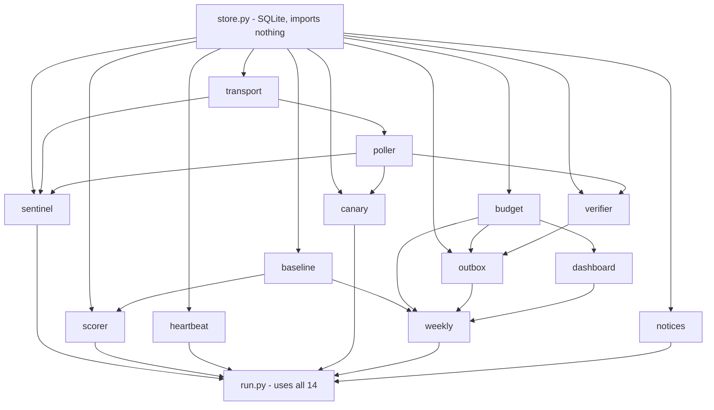

# Flight Monitor

A personal cheap-flight radar. It watches round trips from the San Francisco Bay Area (SFO/OAK/SJC) and sends an alert only when a fare is **unusually cheap for its route**: at most 70% of that route's typical price over the last 28 days, and still that price on a live recheck of the exact itinerary.

- **Destinations and trips** (`watches.yaml`): Japan and Hong Kong for about 4 weeks, departing 1–6 weeks or 3–9 months out; New York for 1 or 2 weeks, departing 1–6 weeks out; LA and San Diego for weekend trips (leave Friday or Saturday morning, back Sunday). Economy, at most 1 stop.
- **Data:** Google Flights through the [fli](https://github.com/punitarani/fli) library (pinned commit, see `requirements.txt`).
- **Runs on:** Muse's scheduler, as an agent turn every 30 minutes that runs `run.py check --scheduled` and relays alerts verbatim to Yaozu's phone. Requests are capped per day, and the monitor backs off when Google pushes back.
- **Built by:** Claude Code writes the code, Codex reviews, CI grades, Yaozu approves every deploy. See `WORKFLOW.md`; the deploy runbooks Muse follows are in `ops/muse-inbox/`.

For the full architecture, rules, and decisions made after the spec, read **`CLAUDE.md`**. The original design is in `docs/spec.md`, the redesign (relative alerts, departure windows, budget steps) in `docs/redesign-spec.md`.

## About this repository

This is a personal project, shared so the design and engineering can be read. It is not a product or a service, and it is not affiliated with Google or Muse.

- **No license.** You may read the code, but no rights to copy, modify or reuse it are granted.
- **Running it yourself:** it isn't packaged for that. If you want flight data, use [fli](https://github.com/punitarani/fli) directly, and respect Google's terms of service and rate limits.
- **No secrets are stored here.** Runtime settings (the heartbeat URL) live in an `.env` file on the host, outside the repository.

## How the modules connect

An arrow means "is used by". `run.py` imports all 14 modules, so its arrows are left out except for the top layer.



## What each file does

| File | Job |
|---|---|
| `run.py` | The CLI and only entry point. `check --scheduled` is the 30-minute cycle: lock, drain queued alerts, collect, score, verify, queue, heartbeat. |
| `sentinel.py` | Picks which departure dates to search each run: every date in each watch's windows, each rechecked on its own target (72 h near-term, 120 h far-out), most overdue first. A verified deal starts a "burst" that searches nearby dates. |
| `poller.py` | Runs the actual Google Flights searches through fli (broad scan and exact-date search). |
| `transport.py` | Wraps every real HTTP request fli makes: counts it against the budget, and backs off on 429s, CAPTCHAs and blank pages (at least 6 hours after the 3rd block in a day). |
| `budget.py` | The daily request limit (`daily_ceiling` in `watches.yaml`, now 225/day) with per-category caps. Refuses requests once they are spent. |
| `store.py` | SQLite database: prices, alerts, budget ledger, health, lock. |
| `scorer.py` | Flags fares at or below the route's alert threshold (70% of its typical price, once the route has enough history). |
| `verifier.py` | Rechecks a flagged fare live. No alert unless the same itinerary is still under the threshold. |
| `outbox.py` | Turns confirmed deals into alert messages and queues them for Muse. At most one alert per watch per departure week. It re-alerts only if the price drops at least max($15, 5%), or 72 hours after the earlier alert was retired (fare gone, or rechecks kept failing). |
| `baseline.py` | Each route's typical price: the median of its last 28 days of fares. A route arms once it has 50 samples on 14 days. |
| `notices.py` | One-time messages to Yaozu when a milestone is reached: alerts live for a destination, or the next budget step ready. |
| `weekly.py` | Monday price report, sent even with no deals. Built from stored data only. |
| `dashboard.py` | Builds the dashboard link. The data rides in the URL fragment, so the page (`dashboard/`) holds none. |
| `heartbeat.py` | Pings healthchecks.io after each scheduled run, or `/fail` on a crash. If pings stop, healthchecks.io emails Yaozu. |
| `canary.py` | Manual diagnostic: one fixed reference search to check that Google Flights still returns data (`run.py canary`). |
| `watches.yaml` | Destinations, departure windows, trip lengths, refresh targets and the daily limit. |
| `tests/` | Offline test suite. `fake_transport.py` stands in for Google, so tests never touch the network. |
| `ops/muse-inbox/` | Dated instructions for Muse. The newest file is the current task. |

## Setup and tests

```bash
python3 -m venv .venv && .venv/bin/pip install -r requirements.txt
.venv/bin/python -m unittest discover -s tests
```

CI (`.github/workflows/tests.yml`) runs the same suite on every push and PR.

## Commands

```bash
.venv/bin/python run.py check --scheduled   # the scheduled cycle (Muse runs this)
.venv/bin/python run.py canary              # is Google Flights still returning data?
.venv/bin/python run.py weekly-report       # preview the Monday report
.venv/bin/python run.py dashboard-link      # print the dashboard link
.venv/bin/python run.py outbox-list         # list outbox alerts (all states)
```

Other commands: `narrow`, `outbox-mark`, `outbox-confirm`, `report-mark`. `broad` is disabled (it returns `broad_scan_disabled`). Run `run.py <command> -h` for options. Don't run real searches from a laptop without Yaozu's OK: they spend the shared Google rate limit.

## History

`PLAN.md` and `PROGRESS.md` are Muse's original plan and Phase 1 report, kept for history only.
