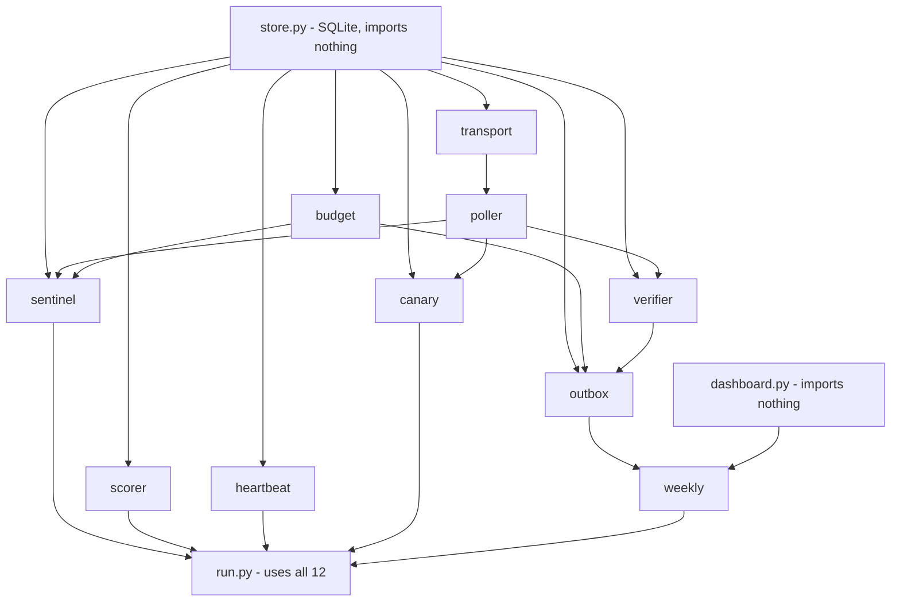

# Flight Monitor

Personal cheap-flight radar. It watches SFO/OAK/SJC round trips to destination groups (currently Japan under $500 and NYC under $250), 3–9 months out, 5–14-day trips, economy, at most 1 stop. It alerts only on fares that are under the cap **and** confirmed by a live recheck of the same itinerary.

- **Data:** Google Flights through the [fli](https://github.com/punitarani/fli) library (pinned commit, see `requirements.txt`).
- **Runs on:** Muse, which runs `run.py check --scheduled` every 30 minutes and pushes alerts to Yaozu's phone.
- **Built by:** Claude Code writes the code, Codex reviews, CI grades, Yaozu approves deploys. See `WORKFLOW.md`.

For the full architecture, rules, and decisions made after the spec, read **`CLAUDE.md`**. The design is in `docs/spec.md`.

## How the modules connect

An arrow means "is used by". `run.py` imports all 12 modules, so its arrows are left out except for the top layer.



## What each file does

| File | Job |
|---|---|
| `run.py` | The CLI and only entry point. `check --scheduled` is the 30-minute cycle: lock, drain queued alerts, collect, score, verify, queue, heartbeat. |
| `sentinel.py` | Picks which dates to search each run: about 27 weekly departure dates per group, least recently checked first. A cheap hit starts a "burst" that searches nearby dates. |
| `poller.py` | Runs the actual Google Flights searches through fli (broad scan and exact-date search). |
| `transport.py` | Wraps every real HTTP request fli makes: counts it against the budget, and backs off on 429s, CAPTCHAs and blank pages. |
| `budget.py` | The daily request limit (150/day). Refuses requests once it is spent. |
| `store.py` | SQLite database: prices, alerts, budget ledger, health, lock. |
| `scorer.py` | Flags fares at or below the watch's cap. No "new low" alerts. |
| `verifier.py` | Rechecks a flagged fare live. No alert unless the same itinerary is still under the cap. |
| `outbox.py` | Turns confirmed deals into alert messages and queues them for Muse. At most one alert per watch per departure week, unless the price drops at least max($15, 5%). |
| `weekly.py` | Monday price report, sent even with no deals. Built from stored data only. |
| `dashboard.py` | Builds the dashboard link. The data rides in the URL fragment, so the page (`dashboard/`) holds none. |
| `heartbeat.py` | Pings healthchecks.io after each scheduled run, or `/fail` on a crash. If pings stop, healthchecks.io emails Yaozu. |
| `canary.py` | Manual diagnostic: one fixed reference search to check that Google Flights still returns data (`run.py canary`). |
| `watches.yaml` | Routes, caps and schedule settings. |
| `tests/` | Offline test suite. `fake_transport.py` stands in for Google, so tests never touch the network. |
| `ops/muse-inbox/` | Dated instructions for Muse. The newest file is the current task. |

## Setup and tests

```bash
python3 -m venv .venv && .venv/bin/pip install -r requirements.txt
.venv/bin/python -m unittest discover -s tests
```

CI (`.github/workflows/tests.yml`) runs the same suite on every push and PR.

## Commands

```bash
.venv/bin/python run.py check --scheduled   # the scheduled cycle (Muse runs this)
.venv/bin/python run.py canary              # is Google Flights still returning data?
.venv/bin/python run.py weekly-report       # preview the Monday report
.venv/bin/python run.py dashboard-link      # print the dashboard link
.venv/bin/python run.py outbox-list         # show queued alerts
```

Other commands: `broad`, `narrow`, `outbox-mark`, `outbox-confirm`, `report-mark`. Run `run.py <command> -h` for options. Don't run real searches from a laptop without Yaozu's OK: they spend the shared Google rate limit.

## History

`PLAN.md` and `PROGRESS.md` are Muse's original plan and Phase 1 report, kept for history only.
